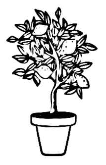

Configure your plant display
============================

ESPHome draws the title, subtitle, icons, gauges, recommendation segments,
pointers and measurements. The only static image contains the plant
illustration. You do not need to generate a full e-paper background.

Choose the illustration and text
--------------------------------

The standalone YAML and shared core use these display-only substitutions:

.. code-block:: yaml

   substitutions:
     screen_title: "Lemon tree"
     secondary_name: "Citrus limon"
     plant_illustration: "images/my-plant.png"
     illustration_x: "10"
     illustration_y: "37"
     illustration_width: "90"
     illustration_height: "90"

Place the plant-only PNG beside your device YAML at the selected path. ESPHome
fits it inside the configured box while preserving its aspect ratio. The image
must not contain a title, icon or gauge. Keep ``id: plant_art`` in the image
component; the normal page reads that ID.

The title uses Audiowide size 20. The subtitle uses size 15. Text is not cut,
wrapped or renamed automatically. Use a short title and check its pixel width.
For Audiowide 20, aim for at most 18 characters and 192 pixels.
ESPHome does not enforce that layout budget. Long subtitles can overlap the clock at the existing position.
Display text does not rename devices or entities.

Keep recommendations, scales and calibration separate
------------------------------------------------------

The standalone defaults match the illustrative, firmware-matched
:download:`legacy JSON <files/lemon-tree-label.json>`. These recommendations
are examples, not care advice for a particular plant.

.. code-block:: yaml

   substitutions:
     light_max: "3775"
     temp_min: "-10"
     temp_max: "50"
     hum_min: "20"
     hum_max: "80"
     soil_recommended_min: "30"
     soil_recommended_max: "60"
     light_recommended_min: "600"
     light_recommended_max: "3775"
     temp_recommended_min: "18"
     temp_recommended_max: "29"
     hum_recommended_min: "20"
     hum_recommended_max: "80"

The soil display scale stays at 0–100%. Light starts at zero. Recommendations
must fit inside their display scale. Invalid values fail the firmware build.
Physical soil voltage calibration remains in the sensor configuration. A care
recommendation does not calibrate the sensor.

The historical graphic fills the ring from its start to the recommendation
**midpoint**. The ESPHome page preserves this meaning. It does not fill only
the interval between the recommendation minimum and maximum. The pointer uses
the same 270-degree scale. Its numeric label shows the raw finite reading;
only its position is clamped. Missing or non-finite measurements show ``--``
without a pointer. Below the warning battery threshold, the normal page inverts.

Home Assistant Plant values stay independent. Align them manually. The page
uses no HA lookup, threshold MQTT messages or automatic HA export. Changing
fixed display values requires a firmware rebuild and deployment.

Legacy generators and printable labels
---------------------------------------

The companion `Label-maker project <https://github.com/JGAguado/Label-maker>`_
and this repository's generic generator remain available. Their full
296 × 128 backgrounds serve historical firmware, print and export workflows.
They are not inputs to the current ESPHome page. Do not put a generated full
background in ``plant_illustration``.

The former :download:`firmware-matched JSON <files/lemon-tree-label.json>` and
background image remain available for reproduction. Generator dependencies
have not been retired. Printable-label use remains separate from firmware.

Validate the configuration and rebuild before any separately authorized flash.
A local build is not deployment evidence. Check the physical panel on one
canary before a fleet rollout. Host previews do not measure e-paper refresh,
ESP32 execution time or battery consumption.
